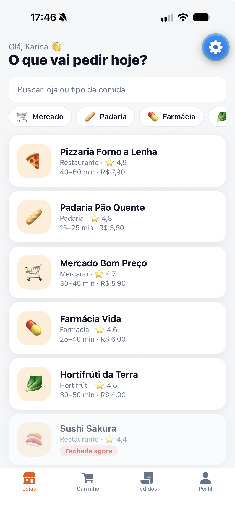
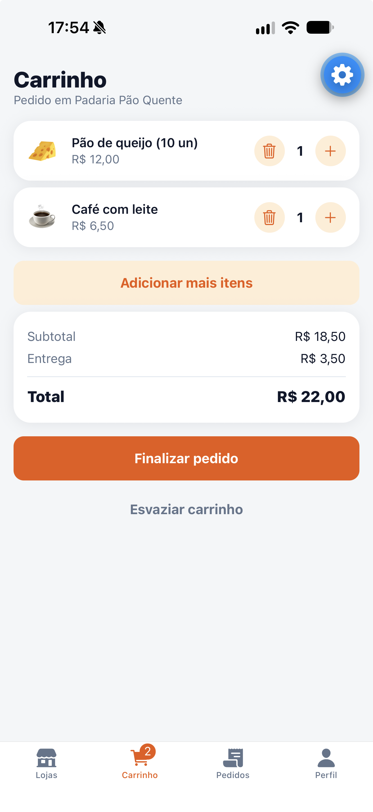
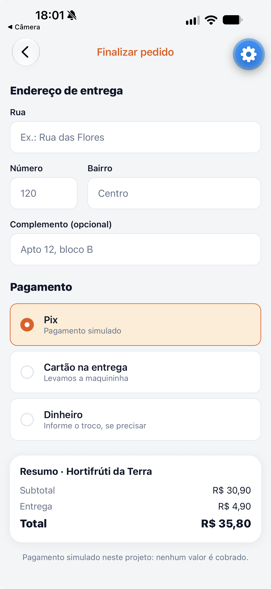
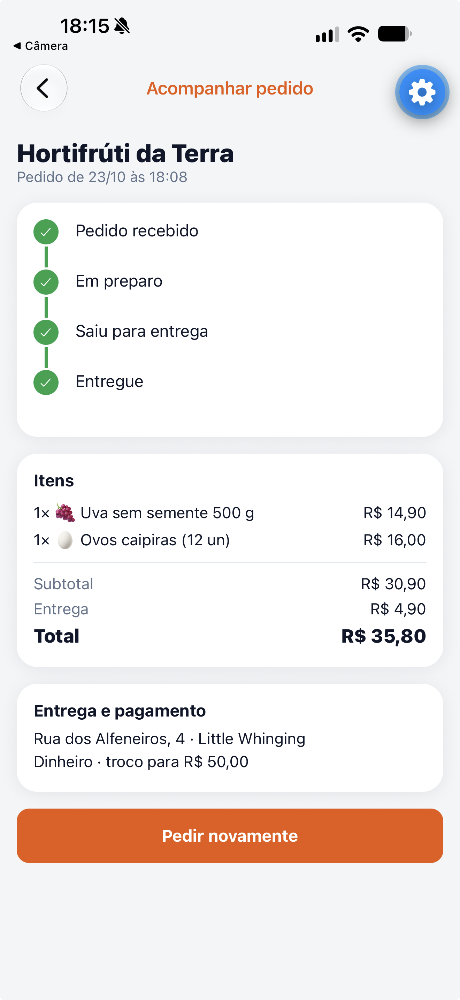

# MarketGo

[](https://github.com/Karina-RM/marketgo/actions/workflows/test.yml)

Aplicativo mobile de compras com entrega: escolha uma loja, monte o carrinho, finalize o
pedido e acompanhe cada etapa até a entrega. Os pagamentos são simulados.

Projeto da disciplina **Programação para Dispositivos Móveis** (IESB, Prof. Me. Bruno Assunção Dias).

| Lojas                                                   | Carrinho                                              | Checkout                                              | Acompanhamento                                             |
| ------------------------------------------------------- | ----------------------------------------------------- | ----------------------------------------------------- | ---------------------------------------------------------- |
|  |  |  |  |

Capturas feitas no iPhone, com Expo Go, durante o roteiro de testes do guia.

## Funcionalidades

- Cadastro, login e sessão persistente (Supabase Auth)
- Catálogo de lojas com busca (sem acento e sem maiúsculas), filtro por categoria e aviso de loja fechada
- Cardápio por seção, detalhe do produto e carrinho **salvo no aparelho, por usuário**
- Regra de negócio: um carrinho por loja, com confirmação para trocar de loja, e pedido mínimo
- Checkout com endereço (preenchido a partir do último pedido), forma de pagamento e troco, validados com Zod
- Pedido criado no banco por uma função que **calcula o total com os preços do servidor**
- Acompanhamento com linha do tempo (atualiza sozinho), cancelamento e "Pedir novamente"
- Histórico de pedidos e dados isolados por usuário (Row Level Security)
- Estados de carregando, erro (incluindo "Sem conexão com a internet.") e vazio
- Carrinho atualizado com os preços e a disponibilidade atuais ao abrir o carrinho e o checkout

**Extras além do guia** (sugestões do Apêndice do guia):

- Avaliação do pedido entregue, de 1 a 5 estrelas e comentário, gravada por uma função no banco
- Cupons de desconto (percentual ou valor fixo, por loja, validade, subtotal mínimo e um uso por pessoa), conferidos e calculados dentro da `create_order`
- Integração contínua: GitHub Actions roda a tipagem e todos os testes a cada push

## Tecnologias

React Native 0.88 · Expo SDK 58 · Expo Router · TypeScript · Supabase (Auth, Postgres, RLS, funções SQL) ·
TanStack Query · React Hook Form · Zod · Jest · PGlite (testes do banco)

## Backend: Supabase local com Docker (gratuito)

O plano gratuito do Supabase na nuvem não estava disponível para este projeto. Por isso, o banco
roda **localmente**, com o mesmo Supabase, pelo Supabase CLI e o Docker. O código do app, o
`schema.sql` (RLS e funções) e os testes são os mesmos que funcionariam na nuvem.

## Requisitos

- Node.js 22 ou superior
- Docker Desktop aberto e rodando
- Celular com **Expo Go para SDK 58** (versão atual da App Store e da Play Store), logado na mesma conta Expo do computador
- Celular e computador na mesma rede Wi-Fi

## Como executar

1. Instale as dependências: `npm install`
2. Suba o Supabase local (a primeira vez baixa as imagens do Docker):
   `npx supabase start`
   Se aparecer `port is already allocated`, outro projeto Supabase local está usando as portas
   54321 a 54327. Pare esse projeto (`npx supabase stop` na pasta dele) ou mude as portas em `supabase/config.toml`.
3. Abra o Studio em **http://127.0.0.1:54323** → **SQL Editor** e execute, em consultas separadas
   e nesta ordem, o **conteúdo** de `supabase/schema.sql`, `supabase/seed.sql` e de cada arquivo
   de `supabase/extras/` (por exemplo, `cat supabase/schema.sql | pbcopy` e cole no editor).
   Os arquivos de `extras/` podem ser executados mais de uma vez.
4. Veja a chave pública com `npx supabase status` (campo **Publishable**). A chave **Secret** nunca vai no app.
5. Crie o `.env` a partir do exemplo (`cp .env.example .env`) e preencha:
   ```
   EXPO_PUBLIC_SUPABASE_URL=http://IP-DO-SEU-COMPUTADOR:54321
   EXPO_PUBLIC_SUPABASE_KEY=sb_publishable_...
   ```
   Use o IP do computador na rede local (no Mac: `ipconfig getifaddr en0`), e não `127.0.0.1`,
   porque o celular não enxerga o localhost do computador. A porta `:54321` é obrigatória.
6. Faça login no Expo (`npx expo login`) e inicie o app: `npx expo start -c`.
   Leia o QR Code com a câmera do iPhone ou com o Expo Go no Android.

> Se o app disser que não encontra uma função depois de alterar o `schema.sql`, rode
> `notify pgrst, 'reload schema';` no SQL Editor.

### Alternativa: Supabase na nuvem

Com um projeto Supabase na nuvem, o caminho é o mesmo: execute `schema.sql` e `seed.sql` no SQL
Editor do projeto e use a URL e a chave públicas dele no `.env`.

## Segurança em uma linha

O app **não escreve** em `orders` nem em `order_items`: só existem políticas de leitura (`SELECT`).
Toda escrita passa por funções (`create_order`, `advance_order`, `cancel_order` e, nos extras,
`rate_order`) que validam os dados, calculam os preços e o desconto do cupom no banco e controlam
o status. O app envia só ids, quantidades e, se houver, o código do cupom. A tabela de cupons nem
pode ser lida pelo app.

Achado durante os testes no Supabase local: o `revoke ... from public` do guia não remove a permissão
que o Supabase dá diretamente ao papel `anon` em funções novas, e visitantes podiam executar
`advance_order`, `cancel_order` e `rate_order` (sem efeito, porque elas exigem o dono do pedido).
`supabase/extras/03-permissoes.sql` fecha isso, e `supabase/tests/permissoes.test.mjs` reproduz
o comportamento do Supabase para o teste não depender de lembrar disso.

## Testes

| Comando             | O que testa                                                                                                 |
| ------------------- | ----------------------------------------------------------------------------------------------------------- |
| `npm test`          | Tudo: app (Jest) e banco (PGlite), **78 testes**                                                            |
| `npm run test:app`  | Carrinho (com atualização de preços), catálogo, pedidos, checkout, dinheiro, erros, avaliação e cupons (48) |
| `npm run test:db`   | RLS, permissões, cálculo do pedido, status, avaliação, cupons e permissões como no Supabase (30)            |
| `npm run typecheck` | Tipagem TypeScript de todo o projeto                                                                        |

São os 50 testes do guia, mais 1 teste de regressão criado durante o roteiro manual (mensagem de
"sem conexão" no modo avião), 9 testes do extra de avaliação (3 no app e 6 no banco) e 12 do
extra de cupons (3 no app e 9 no banco), 2 de permissões, que simulam os privilégios padrão do
Supabase (ver "Segurança"), e 4 da atualização de preços do carrinho. O teste do banco usa o PGlite (Postgres real dentro do Node), com o
mesmo `schema.sql` e `seed.sql`, sem Docker e sem internet.

A cada push no GitHub, o workflow [`Testes`](.github/workflows/test.yml) instala o projeto do zero
(`npm ci`) e roda a tipagem e todos os testes. O selo no topo deste README mostra o resultado.

O roteiro manual de 18 cenários do guia foi executado no iPhone, e os 18 foram aprovados.
Resultados e capturas estão em [`docs/evidencias/registro.md`](docs/evidencias/registro.md).

## Arquitetura

```
app/         rotas (Expo Router): (auth), (app)/(tabs), store, product, checkout, order
src/
  components/ interface reutilizável
  constants/   categorias, pagamento e status
  context/     sessão e carrinho
  hooks/       consultas e mutações (TanStack Query)
  lib/         cliente Supabase e QueryClient
  schemas/     validação (Zod)
  services/    acesso ao Supabase (RPC e leituras)
  theme/       cores, espaçamentos e raios
  utils/       regras puras, cobertas por testes
supabase/
  schema.sql, seed.sql   banco, RLS e funções
  config.toml            configuração do Supabase local
  tests/                 testes do banco (PGlite)
__tests__/               testes das regras do app (Jest)
docs/                    evidências (capturas e registro dos testes)
```

Regra de dependência: tela → hook → serviço → Supabase. As telas nunca importam o Supabase
diretamente. As regras de negócio ficam em `utils/` (funções puras) e em `supabase/schema.sql`.

## Autora

**Karina Ribeiro Modesto**

- GitHub: https://github.com/Karina-RM
